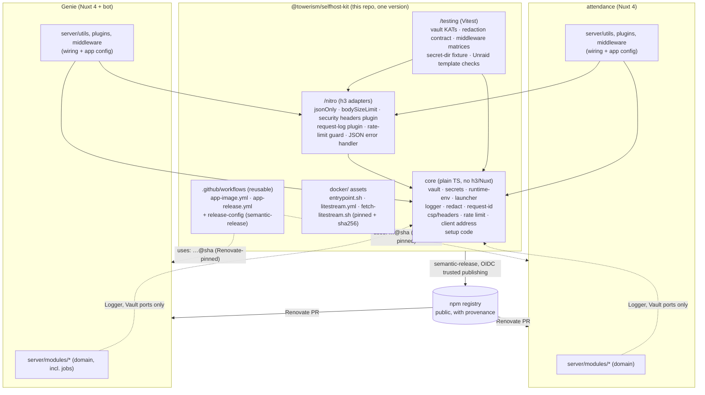
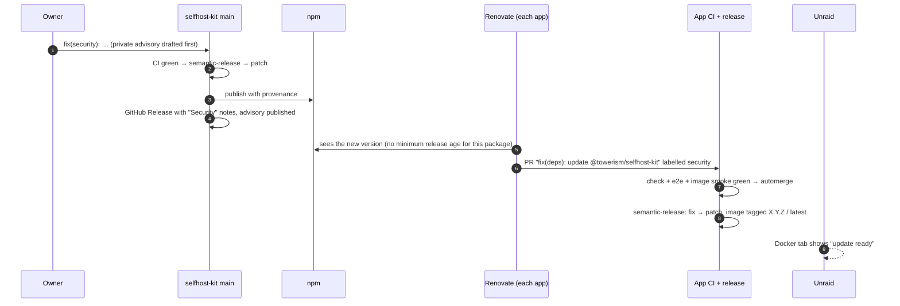

# selfhost-kit — Architecture

Status: **Accepted** (by the owner, 2026-10-13) · Date: 2026-10-13 · Author: Martin Fracker, Jr.

`@towerism/selfhost-kit` is a shared platform package for the owner's self-hosted Nuxt 4 apps. It holds
the security-sensitive infrastructure that both apps would otherwise copy: the AES-256-GCM vault, the
secret bootstrap and launcher, log redaction, the security middleware, the one-time setup code, the
container entrypoint and the image/release CI.

## 1. Context

Two apps by the same author run side by side on one Unraid server, on the same stack: Nuxt 4 with the Nitro
`node-server` preset, SQLite (WAL) + Drizzle, `nuxt-auth-utils`, Vitest, Playwright, pnpm, and a GHCR image
installed from an Unraid template.

| App | State | What it keeps secret |
| --- | ----- | -------------------- |
| [play-pokemon-attendance-web](https://github.com/Towerism/play-pokemon-attendance-web) ("attendance") | Mature, about 280 commits, in production | play-tools refresh tokens for up to 10 professors; an encrypted archive of TDF files that hold minors' birthdates |
| Tournament Genie ("Genie"), Discord bot + website | Architecture accepted (README, ADR-0001…0010); no code yet | Discord bot token, OAuth client secret, attendance integration token |

Genie's architecture says it will reuse attendance's "secret bootstrap, launcher, Unraid template, CI,
release flow" and its "token vault" pattern "almost as-is" (Genie ADR-0001, ADR-0009, §3).

**The finding (adversarial review, Warning #5):** the infrastructure would be copied, not shared. Copying
creates two versions of security-sensitive code (the vault, the secret bootstrap, log redaction), so a fix
in one never reaches the other.

### 1.1 What the study of the code found

Read from attendance's tree at 284 commits, and Genie's docs at `dbe1ba1`:

1. **The two vaults in attendance are already one cipher.** `server/modules/vault/vault.ts` is the
   AES-256-GCM implementation (61 lines). `server/modules/pokemon/vault/vault.ts` (34 lines) is a thin
   adapter over it: strings in and out, and `VaultError` rethrown as `TokenVaultError`. Its golden-blob
   test shows the wire format was kept when the vault was generalised. The duplication the finding
   describes exists **between apps** (once Genie copies it), not inside attendance. Merging the adapter
   into the kit is still in scope ([ADR-0007](adr/0007-migration.md)).
2. **The candidate code is young and has had no fixes yet.** Every candidate path has 1–5 commits, all
   from 2026-10-10 to 2026-10-13, and none of them are `fix:` commits. CI (`.github/workflows/ci.yml`, 9
   commits) changes most often. So the case for sharing doesn't rest on drift that has already happened.
   It rests on what the two copies would contain (table below) and on what a missed security fix would
   cost.
3. **What would actually differ between the two copies is data, not logic.** For each piece, Genie's
   documented needs compared with attendance's code:

   | Piece (attendance file) | Lines | What Genie's copy would change |
   | ----------------------- | ----: | ------------------------------- |
   | Vault (`modules/vault/vault.ts`) | 61 | Nothing in the cipher. Purpose labels and key names are parameters. |
   | Secret resolution (`bootstrap/secrets.ts`) | 88 | The list of secret specs (`vault.key` instead of `token-vault.key` + `tdf-vault.key`). The mechanism is unchanged. |
   | Runtime env (`bootstrap/runtime-env.ts`) | 68 | The secret list and the names of the rate-limit tuning variables. |
   | Launcher (`bootstrap/launcher.ts`) | 23 | Nothing. |
   | Logger + port (`logging/logger.ts`, `types.ts`) | 164 | Nothing. |
   | Redaction (`logging/redact.ts`) | 99 | The key list: Genie adds `notes`, the bot token and its vault key name, and drops the TDF and birthdate keys. The walker and the scrubber are unchanged. |
   | Request id + request log (`logging/request-id.ts`, `plugins/logging.ts`) | 63 | Nothing. |
   | Security headers / CSP (`modules/security/headers.ts`, `plugins/security-headers.ts`) | 97 | Possibly extra CSP sources (for example Discord's avatar CDN). Genie's transcript view sets its own per-route CSP. |
   | Rate limiter, client address, trusted proxies (`modules/security/*`) | 139 | Nothing. Which routes are limited is app wiring. |
   | JSON-only and body-size middleware (`middleware/*`) | 28 | Which paths are exempt (attendance exempts its TDF preview). |
   | Setup code (`modules/accounts/setup-code.ts`) | 24 | Nothing. *When* the code stops working differs, and that stays in each app. |
   | JSON error handler (`server/error.ts`) | 13 | Nothing. |
   | Entrypoint + Litestream (`docker/entrypoint.sh`, `litestream.yml`) | 81 | Nothing (Genie ADR-0009 names "the entrypoint" as reused). |
   | Image + release CI (`ci.yml` image and release jobs, `.releaserc.json`) | ≈150 | The image name and the smoke-test scripts. |
   | Unraid template (`deploy/unraid/*.xml`) | 39 | Nearly every line: name, port, paths, variables. |
   | Job runner, leases, recovery (`modules/submission/service.ts`) | (inside 2,084) | No overlap. Attendance's lease is about 40 lines inside the submission service, tied to its tables (`submission_lock`, staff batches handing the lease over with negative ids) and to its kinds of job. There is no general runner to extract. |

   About **1,060 lines of production code and about 1,060 lines of unit tests** would be copied where the
   only per-app difference is configuration. The Unraid template and the job runner are the exceptions.
4. **The core is used before Nitro exists.** The launcher logs and resolves secrets before Nitro is
   imported, and `nuxt.config.ts` imports the CSP builder and the default trusted proxies at build time. So
   the shared code must be plain TypeScript that doesn't depend on a running Nitro. Both apps' "modules are
   plain TS" rule already requires this.
5. **Attendance's §9 lists Renovate under supply chain, but attendance has no Renovate config.** The fast
   path for getting a fix into both apps ([ADR-0005](adr/0005-versioning-and-security-fixes.md)) depends on
   adding one. It is a follow-up issue (§12).

## 2. Goals and non-goals

### Goals

- **G1 One copy of the security-sensitive code.** The vault, the secret bootstrap, redaction, the security
  middleware and the setup code exist once, in this package, and both apps import them.
- **G2 A fix reaches both apps quickly.** A security fix released here becomes a pull request in each app
  within hours, and lands in a released image once its CI is green
  ([ADR-0005](adr/0005-versioning-and-security-fixes.md)).
- **G3 Existing installs keep working.** Attendance moves onto the package with no change to `/data`: the
  same secret file names and environment variables, and the same vault blob format, so every existing
  ciphertext and key file still decrypts ([ADR-0007](adr/0007-migration.md)).
- **G4 Framework-free core.** Plain TypeScript, testable without Nuxt, with thin Nitro/h3 adapters on a
  separate entry point ([ADR-0006](adr/0006-api-boundaries.md)).
- **G5 Genie starts on the package from day one.** Its M1 skeleton imports the kit and never copies.
- **G6 Contract tests the apps can run.** Crypto known-answer vectors and middleware suites that each app
  runs against its own configuration ([ADR-0008](adr/0008-testing-strategy.md)).

### Non-goals

- A general framework for other people's apps. The package is public, but it serves these two apps. Its
  API follows what they need and nothing more.
- The job runner. It stays in each app for now ([ADR-0002](adr/0002-scope.md) explains why and when that
  would change).
- Domain code: auth flows, the Pokémon or Discord integrations, the database client and migrations.
- Key rotation and multi-key vaults. The blob's version byte leaves room for them (§6.1). They aren't
  built.
- A Nuxt module or layer that wires everything up by itself ([ADR-0001](adr/0001-share-as-a-package.md)).
- Multi-arch images. Both apps target Unraid on amd64 only.

### Quality attributes (ranked)

1. **Security correctness.** The cipher, secret handling and redaction must be right, because both apps
   inherit any mistake. Every change to them is covered by known-answer and contract tests.
2. **Compatibility with data at rest.** Nothing in a release may stop an existing `/data` folder from
   working, or stop the previous release in the same major from reading what the new one wrote (so a
   rollback stays safe).
3. **Speed of fix propagation.** A patch release reaches both apps' `main` without hand-editing.
4. **Low consumer effort.** An app adopts a piece by importing it and passing its configuration. It needs
   no plugin magic and no code generation.
5. **Small surface.** Fewer exports mean fewer things to keep compatible. Anything only one app needs
   stays in that app.

## 3. Architecture at a glance

**Pattern:** a single npm package with a framework-free **core** (ports and plain functions), a thin
**`/nitro` adapter** entry point for h3/Nitro, a **`/testing`** entry point of contract suites and
known-answer vectors, and **Docker assets** (the entrypoint script and the Litestream config and pin). CI is
shared through **reusable GitHub workflows** and a **shareable semantic-release config** from the same
repository.



What lives where (details in [ADR-0002](adr/0002-scope.md)):

| In the kit | Stays in each app |
| ---------- | ----------------- |
| AES-256-GCM vault, string helper, `VaultError` | Which secrets are sealed, and their AAD strings |
| `SecretSpec`, `resolveSecret`, spec builders, `prepareRuntimeEnv`, `runLauncher` | The list of secret specs and the app's own config validation |
| Logger, redaction (base key list + app extras), request ids | The app's extra redaction keys; `useLogger` wiring |
| CSP and header builder, nuxt-security hook plugin | Extra CSP sources; per-route policies |
| Fixed-window limiter, client address, trusted proxies, `enforceRateLimit` | Which routes are limited and how much |
| `jsonOnly`, `bodySizeLimit`, JSON error handler | Exempt paths |
| Setup code generate/match | When the code is printed and when it stops working |
| Entrypoint, Litestream config, Litestream pin | The Dockerfile itself, the app's stages and paths |
| Image + release reusable workflows, release config | `check` and `e2e` jobs; the app's smoke scripts |
| Unraid template *checks* (`/testing`) | The Unraid template |
| — | Job runner, leases, timers; DB; auth; integrations |

## 4. Repository layout

```
src/
  core/                     framework-free; no h3, nitropack, nuxt or #imports (lint + test enforced)
    vault/                  createVault, stringVault, VaultError, blob format v1
    secrets/                SecretSpec, resolveSecret, sessionPassword(), aes256Key(), InvalidSecretError
    runtime/                prepareRuntimeEnv, InvalidConfigError, runLauncher
    logging/                createLogger, Logger port, silentLogger, redact/scrub, base key list, acceptRequestId
    security/               contentSecurityPolicy, securityHeaders, isHttpsSite,
                            createFixedWindowLimiter, parseTrustedProxies, clientKey, normalizeAddress
    setup-code/             generateSetupCode, setupCodeMatches
    clock.ts                Clock port (now()) used by the limiter; fakeClock lives in /testing
    index.ts                the package root export
  nitro/                    h3/Nitro adapters only; imports core + h3
    middleware.ts           jsonOnly, bodySizeLimit
    plugins.ts              securityHeadersPlugin, requestLogPlugin
    rate-limit.ts           enforceRateLimit
    error.ts                jsonErrorHandler
    index.ts
  testing/                  Vitest helpers and contract suites the apps import
    vault-kat.ts            known-answer vectors + describeVaultContract()
    redaction.ts            describeRedactionContract(redactor, { mustHide, mustShow })
    middleware.ts           describeJsonOnly(), describeBodySize(), describeSecurityHeaders()
    secrets.ts              tempSecretsDir(), fixtures of an existing install's secrets/
    clock.ts                fakeClock()
    unraid.ts               checkUnraidTemplate(xml, { image, secretTargets })
    index.ts
  cli/
    index.ts                the `selfhost-kit` command's logic (docker-assets); not part of the import API
docker/
  entrypoint.sh             PUID/PGID/UMASK, gosu, optional Litestream supervision
  litestream.yml            replicates the database only, never secrets/
  fetch-litestream.sh       the one Litestream version + sha256 pin, used by app Dockerfiles
bin/
  selfhost-kit.mjs          a shim over dist/cli/index.js: `selfhost-kit docker-assets <dir>` copies docker/ out
                            of node_modules (real files)
release-config/
  index.js                  shareable semantic-release config (conventionalcommits + exec + github), plain ESM
  index.d.ts                its hand-written types
  notes.js                  the release-notes helpers (Security section, advisory links), shared with the kit's
                            own release.config.mjs
.github/workflows/
  ci.yml                    the kit's own CI: lint, typecheck, test + coverage, shellcheck, entrypoint image test
  release.yml               semantic-release → npm (provenance) + GitHub Release
  app-image.yml             reusable: build, smoke-test and publish an app image; outputs the digest
  app-release.yml           reusable: semantic-release dry run, tag the tested digest, git tag + Release
test/
  entrypoint/               fixture image + shell tests for docker/entrypoint.sh
docs/
  architecture/             this document + ADRs
  adopting.md               how an app wires the kit in (written in M1)
SECURITY.md                 how to report a vulnerability (private advisory); supported versions
```

## 5. API sketches

Signatures are illustrative. Each issue's spec fixes the exact API. All core functions take their inputs
as arguments and never read `process.env` themselves, except where a default is documented
(`createLogger` reads `NUXT_LOG_LEVEL` and `NUXT_LOG_FORMAT`, as attendance does today).

### 5.1 Vault (`@towerism/selfhost-kit`)

```ts
/** AES-256-GCM. Blob v1: version (1) | iv (12) | tag (16) | ciphertext. Byte-for-byte attendance's format. */
export interface Vault {
  seal(plaintext: Uint8Array, aad: string): Buffer;
  /** @throws VaultError: malformed, tampered with, another key or another AAD. */
  open(blob: Uint8Array, aad: string): Buffer;
}
export class VaultError extends Error {}

/** @param key 32 bytes, standard base64 (what the secret files hold). `label` only names the vault in errors. */
export function createVault(opts: { key: string; label: string }): Vault;

/** UTF-8 strings over a Vault, for tokens and secrets. Errors stay VaultError. */
export function stringVault(vault: Vault): {
  encrypt(plaintext: string, aad: string): Buffer;
  decrypt(blob: Uint8Array, aad: string): string;
};
```

Rules: an empty AAD is refused (every existing caller passes one, and a blob with no row binding can be
moved to another row unnoticed). Error messages keep attendance's wording: "The {label} vault key must be
32 bytes, base64-encoded." The key never appears in an error.

### 5.2 Secrets, runtime env and launcher

```ts
export interface SecretSpec {
  env: string;                         // env var that overrides the file
  file: string;                        // file name inside the secrets dir
  label: string;                       // for the startup log line
  generate(): string;
  problem(value: string): string | null;   // never echoes the value
}
export function sessionPassword(): SecretSpec;                       // NUXT_SESSION_PASSWORD / session-password
export function aes256Key(o: { env: string; file: string; label: string }): SecretSpec;
export function resolveSecret(spec: SecretSpec, o: { env: Env; dir: string }):
  { value: string; source: 'env' | 'file' | 'generated' };

export function prepareRuntimeEnv(input: Env, o: {
  secrets: SecretSpec[];
  positiveIntegerVars?: string[];      // blank → removed; otherwise must be a whole number ≥ 1
  validate?: (env: Env) => void;       // app's own checks; throw InvalidConfigError
}): { env: Env; log: string[] };
// Also: derives NUXT_SESSION_COOKIE_SECURE from NUXT_PUBLIC_SITE_URL unless set; validates NUXT_TRUSTED_PROXIES.

/** Resolve the env, log the lines, exit 1 on InvalidSecretError/InvalidConfigError, then import the server. */
export function runLauncher(o: { prepare: (env: Env) => { env: Env; log: string[] }; server: URL; logger?: Logger }): Promise<void>;
```

An app's launcher becomes:

```ts
// server/bootstrap/launcher.ts (attendance, after migration)
import { aes256Key, prepareRuntimeEnv, runLauncher, sessionPassword } from '@towerism/selfhost-kit';

const SECRETS = [
  sessionPassword(),
  aes256Key({ env: 'NUXT_TOKEN_VAULT_KEY', file: 'token-vault.key', label: 'Token vault key' }),
  aes256Key({ env: 'NUXT_TDF_VAULT_KEY', file: 'tdf-vault.key', label: 'TDF vault key' }),
];
await runLauncher({
  prepare: (env) => prepareRuntimeEnv(env, { secrets: SECRETS, positiveIntegerVars: AUTH_RATE_LIMIT_VARS }),
  server: new URL('./server/index.mjs', import.meta.url),
});
```

### 5.3 Logging

```ts
export interface Logger { error; warn; info; debug; child(scope: string, bindings?: Record<string, unknown>): Logger }
export const silentLogger: Logger;

/** Base keys (credentials) are always hidden. `extraKeys` adds to them; nothing can remove one. */
export function createRedactor(o?: { extraKeys?: string[] }): { redact(v: unknown): unknown; scrub(s: string): string; isSensitiveKey(k: string): boolean };
export const BASE_SENSITIVE_KEYS: ReadonlySet<string>;   // token, accessToken, refreshToken, idToken, authorization,
  // proxyAuthorization, cookie, setCookie, password, sessionPassword, secret, clientSecret, secretAccessKey,
  // codeVerifier, authorizationCode, and the NUXT_/LITESTREAM_ env names of kit-owned secrets
export function secretKeyNames(specs: SecretSpec[]): string[];  // env names of app secrets, for extraKeys

export function createLogger(o: { scope: string; redactor?: Redactor; level?: string; format?: string;
  context?: () => Record<string, unknown> | undefined; destination?: LogDestination }): Logger;
export function acceptRequestId(header: string | string[] | undefined): string;
```

Attendance passes `extraKeys: ['birthdate', 'dateOfBirth', 'dob', 'content', 'payload', ...secretKeyNames(SECRETS)]`.
Genie passes `['content', 'notes', 'botToken', ...secretKeyNames(SECRETS)]`. The pretty line format and the
setup-code log line stay exactly as attendance prints them, because attendance's container smoke test and
deploy guide depend on them.

### 5.4 Security

```ts
export function isHttpsSite(siteUrl: string | undefined): boolean;
/** Additive only: `extra` can add sources to a directive, never remove the base policy's. */
export function contentSecurityPolicy(o: { httpsSite: boolean; nonce?: boolean; extra?: Partial<Record<Directive, string[]>> }): CspDirectives;
export function securityHeaders(o: { httpsSite: boolean; csp?: CspDirectives }): Record<string, string>;

export function createFixedWindowLimiter(o: { max: number; windowMs: number; capacity?: number; clock?: Clock }): FixedWindowLimiter;
export const DEFAULT_TRUSTED_PROXIES: string;
export function parseTrustedProxies(value: string): TrustedProxies;   // throws InvalidTrustedProxiesError
export function clientKey(o: { remoteAddress?: string; xForwardedFor?: string; trusted: TrustedProxies }): string;

export function generateSetupCode(): string;                       // XXXX-XXXX, 32-symbol alphabet
export function setupCodeMatches(expected: string, given: string): boolean;   // constant time
```

### 5.5 Nitro adapters (`@towerism/selfhost-kit/nitro`)

The adapters take configuration as arguments and never call `useRuntimeConfig`, so they work the same in
both apps and in tests.

```ts
export function jsonOnly(o?: { prefix?: string; exempt?: RegExp[] }): EventHandler;          // 415
export function bodySizeLimit(o: { maxBytes: number; prefix?: string; exempt?: RegExp[] }): EventHandler;  // 413
export function securityHeadersPlugin(o: { siteUrl?: string; extraCsp?: …; nuxtSecurity?: boolean }): NitroAppPlugin;
export function requestLogPlugin(o: { logger: Logger; quietPaths?: string[] }): NitroAppPlugin;
export function enforceRateLimit(event: H3Event, o: { limiter: FixedWindowLimiter; trusted: TrustedProxies }): void; // 429 + Retry-After
export function jsonErrorHandler(): NitroErrorHandler;    // keeps the app's CSP on JSON errors
```

Usage in an app is one line per file, for example `server/middleware/json-only.ts`:
`export default jsonOnly({ exempt: [] })`.

## 6. Data at rest and environment contract

### 6.1 Vault blob format

`version (1 byte) | iv (12) | auth tag (16) | ciphertext`, AES-256-GCM, a fresh random IV for each seal,
and the caller's AAD as UTF-8. **Version 1 is frozen.** A future format (for example one with a key id for
rotation) gets a new version byte. Reading a new version can ship in a minor release. *Writing* it by
default is a major release, because the previous release in the same major couldn't read it after a
rollback ([ADR-0005](adr/0005-versioning-and-security-fixes.md)).

### 6.2 `/data` layout

The kit owns the `secrets/` convention. Each app owns the rest of the folder.

```
/data/                          the one volume (Unraid appdata)
  app.db, app.db-wal, app.db-shm   the app's SQLite (path from NUXT_DATABASE_PATH)
  secrets/                      kit: dirname(NUXT_DATABASE_PATH)/secrets, created 0700
    session-password            kit spec sessionPassword()                      0600
    <file>                      app-declared aes256Key specs                     0600
                                  attendance: token-vault.key, tdf-vault.key
                                  Genie:      vault.key
  <app folders>                 e.g. Genie's exports/
```

Rules the kit enforces, unchanged from attendance's ADR-0006:

- An env var always wins over the file.
- A missing file is generated once (`O_EXCL`, mode 0600, directory 0700).
- A malformed value fails startup with a message naming where it came from, and is **never** regenerated.
- File names are part of each app's install contract. The kit never renames or moves one. Litestream
  replicates only the database, never `secrets/`.

### 6.3 Environment variables the kit reads

| Variable | Read by | Meaning |
| -------- | ------- | ------- |
| `NUXT_DATABASE_PATH` | runtime env | Locates `secrets/` (default `.data/app.db` in dev; the image sets `/data/app.db`) |
| `NUXT_SESSION_PASSWORD` | `sessionPassword()` | Overrides `secrets/session-password` |
| app-named key vars | `aes256Key()` | Override their files (attendance: `NUXT_TOKEN_VAULT_KEY`, `NUXT_TDF_VAULT_KEY`; Genie: `NUXT_VAULT_KEY`) |
| `NUXT_PUBLIC_SITE_URL`, `NUXT_SESSION_COOKIE_SECURE` | runtime env, headers | HTTPS detection, the Secure cookie flag, HSTS |
| `NUXT_TRUSTED_PROXIES` | runtime env, rate limit | Validated at startup; blank means the default (loopback and Docker's default bridge pool) |
| `NUXT_LOG_LEVEL`, `NUXT_LOG_FORMAT`, `NO_COLOR` | logger | As attendance |
| `PUID`, `PGID`, `UMASK`, `DATA_DIR` | entrypoint | As attendance |
| `LITESTREAM_REPLICA_URL`, `LITESTREAM_ACCESS_KEY_ID`, `LITESTREAM_SECRET_ACCESS_KEY`, `LITESTREAM_CONFIG` | entrypoint | As attendance |

## 7. How a fix reaches both apps



The owner still clicks *Update* on Unraid. That click is the production gate for both apps today, and it
stays the gate.

## 8. Migration plan (summary of [ADR-0007](adr/0007-migration.md))

Attendance moves one piece at a time, lowest risk first. Each step is its own PR and release. Each step
first runs attendance's **existing tests unchanged** against the kit, through a re-export shim, before any
attendance code is deleted.

| Step | Piece | Gate that proves existing installs are safe |
| ---- | ----- | ------------------------------------------- |
| A1 | Setup code, rate limiter, client address, request id, CSP/headers | Existing unit tests pass through the shim; `test/server/security.test.ts` unchanged |
| A2 | Logger + redaction (with attendance's extra keys) | Existing `redact.test.ts`, `logger.test.ts` and `test/server/logging.test.ts` pass unchanged; the setup-code log line is byte-identical |
| A3 | Secrets, runtime env, launcher | A fixture of an existing `secrets/` (three files) loads with the same values and nothing is regenerated; the container smoke test and the restore drill pass |
| A4 | Vault, and merging the two vaults | The existing golden blob and a corpus of v1 blobs sealed by today's code open with the kit; the `pokemon/vault` adapter is deleted and `connection.ts` catches `VaultError` |
| A5 | Nitro middleware and plugins | Existing server tests pass unchanged |
| A6 | Docker assets | `test/docker/smoke.sh`, `litestream.sh` and `restore-drill.sh` pass unchanged |
| A7 | Reusable image + release workflows | A PR image `:pr-N` publishes, and a release tags the tested digest |

Genie: its M1 skeleton imports the kit from the first commit. It pins an exact 0.x version until the kit
reaches 1.0. Genie's ADR-0001 and ADR-0009 are amended so they say "shared through
`@towerism/selfhost-kit`" instead of "carried over".

## 9. Testing strategy (summary of [ADR-0008](adr/0008-testing-strategy.md))

- **Pyramid:** almost everything is a unit test on pure core functions. Integration tests drive the
  `/nitro` adapters through a real h3 app in memory. Container tests cover the entrypoint. The package has
  no browser E2E tests: the apps' Playwright journeys stay in the apps.
- **Crypto known-answer tests:** fixed key, IV and AAD vectors with expected blob bytes, including
  attendance's golden blob, so the wire format can't change silently. Tamper, wrong-key, wrong-AAD,
  truncated and unknown-version cases must all throw `VaultError`.
- **Contract suites the apps run** (`/testing`): the vault contract, the redaction contract (with each
  app's own must-hide and must-show keys), the middleware matrices and the Unraid template checks, so each
  app proves *its configuration* of the kit is safe.
- **Fake clock:** the limiter takes a `Clock`, so window expiry is tested without real time.
- **Coverage by risk:** 100% branch coverage on vault and redaction, 95% on secrets, runtime env and
  client address, 90% on the rest of core and `/nitro`.

## 10. Risks and mitigations

| Risk | Likelihood | Impact | Mitigation |
| ---- | ---------- | ------ | ---------- |
| A kit bug ships to both apps at once (shared blast radius) | Med | High | Known-answer and contract tests; both apps' full CI runs on every kit bump before merge; the Unraid *Update* click is a manual gate; rollback is reverting the Renovate PR, which is safe because of rule 2 in §2 |
| A refactor changes the vault format or a secret file name and breaks existing installs | Low | High | Format v1 frozen and pinned by KATs; file names are app-declared, never kit defaults that could change; migration gates A3/A4 use fixtures of a real (synthetic) install |
| Renovate PRs pile up or wait, so fixes don't propagate | Med | Med | Automerge for kit patch and minor releases when CI is green; Renovate's `vulnerabilityAlerts` on; a security release also opens a tracking issue in each app |
| The npm scope, or a token, is compromised and publishes a malicious version | Low | High | Trusted publishing (OIDC) with provenance, no long-lived npm token; 2FA on the npm account; apps install with `--frozen-lockfile`; Renovate shows provenance |
| The public repo leaks something private | Low | Med | No store, LAN or person-specific values anywhere, examples use `example.com`, `secret-scan` (gitleaks) in CI; fixtures are generated synthetic values |
| The API grows to fit both apps' corner cases (a framework by accident) | Med | Med | Quality attribute 5; anything only one app needs stays in that app; additions need a consumer in the same PR series |
| A Nitro 3 / h3 v2 upgrade breaks the adapters | Med | Low | Adapters are thin (≈150 lines) and isolated in `/nitro`; the core is unaffected; h3 is a peer dependency with an explicit range |
| Docker build can't copy assets out of pnpm's symlinked `node_modules` | Med | Low | `selfhost-kit docker-assets` copies real files into the build output; the container test proves it |
| Genie's jobs module is later needed by attendance and gets copied after all | Med | Med | ADR-0002 sets the re-entry rule: extract into the kit when a second consumer appears, never copy |

## 11. Delivery milestones

| Milestone | Scope | Exit criteria |
| --------- | ----- | ------------- |
| K0 Repo | This architecture accepted; package skeleton, lint, typecheck, Vitest, CI, `SECURITY.md`, npm trusted publishing set up | First `0.1.0` published with provenance from CI |
| K1 Core | vault, secrets, runtime env, launcher, logging, security, setup code; `/testing` vault, redaction and secret-dir helpers | KATs (including attendance's golden blob) green; coverage targets met |
| K2 Adapters | `/nitro` middleware, plugins, rate-limit guard, error handler; `/testing` middleware matrices | Matrices green against a real in-memory h3 app |
| K3 Ops assets | Docker assets, `docker-assets` bin, entrypoint container tests, reusable `app-image` and `app-release` workflows, shareable release config | The entrypoint test image passes; a sample caller workflow runs |
| K4 Attendance migration | Steps A1–A7 in attendance (attendance issues) | Each step's gate is green; no change to an existing install |
| K5 1.0 | API frozen after the real migration; `docs/adopting.md` | Attendance fully on the kit; Genie M1 on the kit; `1.0.0` released |

Genie's M1 can start once K1 and K2 publish 0.x (exact pin). K3 must land before Genie's image CI exists.

## 12. Follow-up issues

Draft issue text for attendance and Genie is in [follow-up-issues.md](follow-up-issues.md). None of it is
filed yet.

## 13. Architecture Decision Records

| ADR | Title | Status |
| --- | ----- | ------ |
| [0001](adr/0001-share-as-a-package.md) | Share the infrastructure as a package, not a layer, template or copy | Accepted |
| [0002](adr/0002-scope.md) | Scope: what the kit holds, and why the job runner stays out | Accepted |
| [0003](adr/0003-single-package-on-npm.md) | One package with subpath exports, published to public npm with provenance | Accepted (amended 2026-10-13) |
| [0004](adr/0004-sharing-docker-and-ci.md) | Share Docker pieces as package assets and CI as reusable workflows | Accepted (amended 2026-10-13) |
| [0005](adr/0005-versioning-and-security-fixes.md) | Semver, compatibility rules and the security-fix path | Accepted (amended 2026-10-13) |
| [0006](adr/0006-api-boundaries.md) | Framework-free core, thin Nitro adapters, and the `/data` contract | Accepted |
| [0007](adr/0007-migration.md) | Migrate attendance piece by piece behind its existing tests; Genie starts on the kit | Accepted |
| [0008](adr/0008-testing-strategy.md) | Testing strategy: KATs, contract suites the apps run, fake clock | Accepted |
